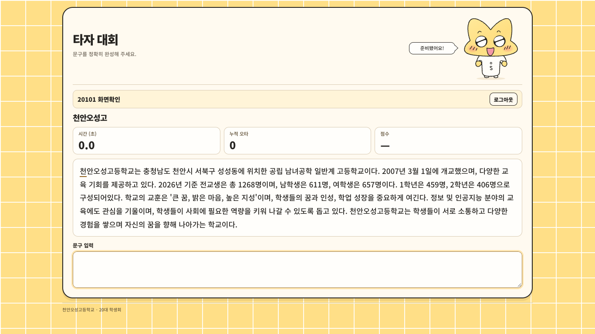
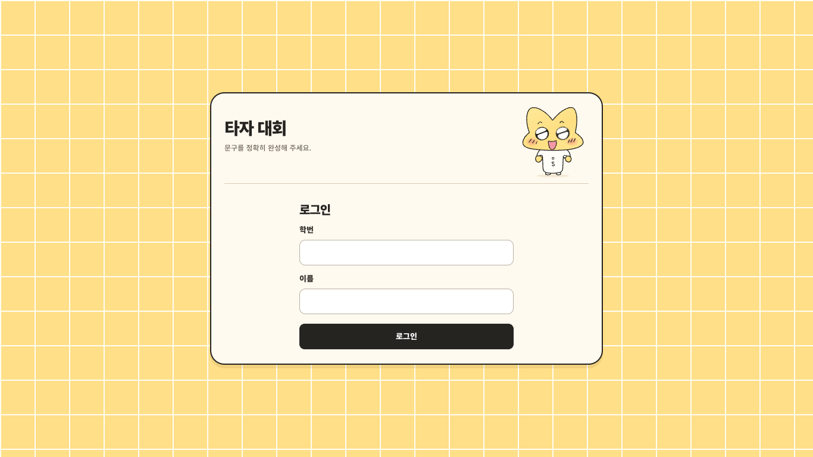
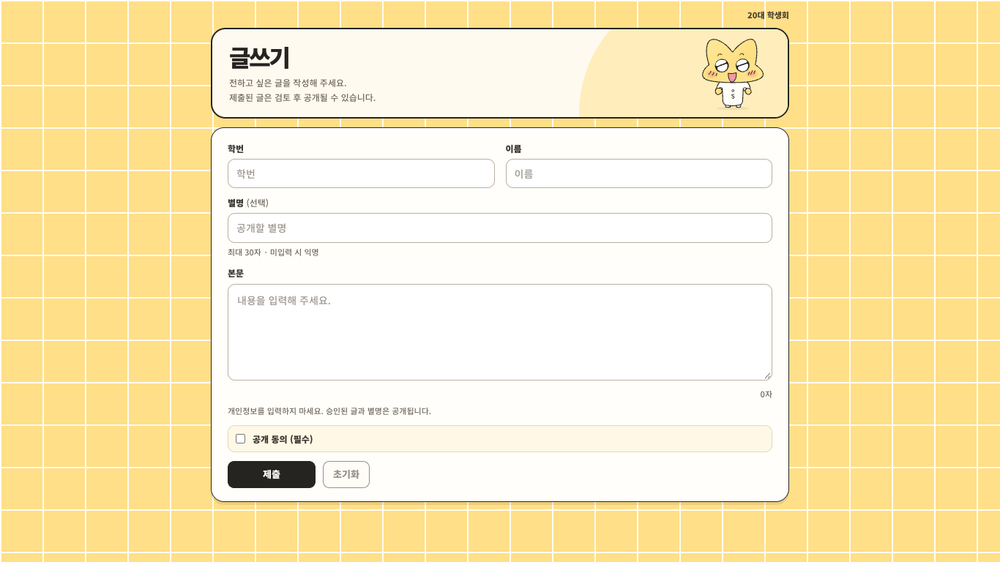

# 삭제 동작·확대된 오별이·간결한 글쓰기

2026-11-16 최신 요청을 반영했다. 작업 브랜치는 `design/obyeol-retro-grid`다.

## 삭제 동작

이전의 “기록을 지워도 참여 제한 유지” 정책을 변경했다. 관리자 삭제는 결과 문서, 동일 접수번호의 타자 영수증, 그 결과를 가리키는 공식 참여 키를 한 트랜잭션에서 삭제한다. 삭제 후 같은 학번으로 새 기록을 제출할 수 있다. 다른 결과를 가리키는 참여 키와 글 접수 영수증은 삭제하지 않는다. 관리자 확인 창도 이 동작을 설명한다.

일부 문서만 삭제되는 작업은 새 규칙이 거절한다. 규칙이 아직 배포되지 않았거나 관리자 권한이 없으면 결과를 먼저 지우지 않고 삭제 전체가 실패하며, 삭제 전용 오류를 표시한다. 이미 없는 결과의 삭제를 재시도해도 오류 없이 처리한다. 예전 삭제로 결과 없이 남은 특정 참여 키는, 관리자가 학번·예상 결과 ID를 지정하고 결과 부재를 다시 확인하는 별도 내부 함수로 정리할 수 있다.

사용자가 원하지 않은 원인 분석 버튼과 진단 함수·진단 테스트는 제거했다. 입력 엔진과 오타당 3점 감점은 변경하지 않았다.

**운영 반영 상태:** 로컬 구현과 테스트는 완료했다. Firebase CLI의 `login:list`가 `No authorized accounts`를 반환하여 운영 프로젝트 `os20th`에는 새 규칙을 아직 배포하지 않았다. 기존 운영 데이터와 남아 있는 참여 키도 이번 작업 중 변경하지 않았다. 실제 삭제·재참여 동작은 규칙과 새 클라이언트를 함께 반영해야 한다.

```sh
npx -y firebase-tools@latest deploy --config db/firebase.json --project os20th --only firestore:rules
```

## 화면 수정

- 진행 화면의 오별이를 82px에서 144px로, 로그인에서는 120px로 확대했다. 윤곽선은 유지하고 노란색 채움만 조금 밝게 했다.
- 말풍선을 작은 폭과 여백으로 줄였다. 로그인 말풍선과 푸터는 숨겨 공간을 차지하지 않는다.
- 채점 규칙 영역과 그 표시용 DOM 연결을 제거했다. 시작 전 운영진이 구두로 고지하는 방식에 맞췄다. 실제 채점·입력 제한은 그대로다.
- 지표·보조 버튼·입력창·여백을 조금씩 줄여 큰 오별이와 문구 전체가 함께 보인다.
- 한글 조합 중인 임시 글자도 현재 입력과 다르면 바로 빨간색으로 표시하도록 되돌리고, 오답 글자색과 밑줄을 더 선명하게 했다. 조합 중 임시 글자를 감점하지 않고 확정된 오타만 세는 채점 로직은 유지했다.
- 글쓰기의 카드 디자인은 유지하고 중복된 소제목, 큰 상단·본문 여백, 푸터를 정리했다. 본문 입력창은 늘려 쓸 수 있으며 길이 제한은 변경하지 않았다. 학번 placeholder는 “학번”으로 바꿨다.
- 수정된 JS·CSS·SVG의 URL 버전을 갱신해 오래된 삭제 함수나 캐릭터가 캐시에 남는 것을 줄였다.

## 검증

이번 작업에서는 모바일 테스트를 실행하지 않았다.

- Chrome 데스크톱 1366×768, 1710×1060에서 중앙 로그인과 입력 반응·기록증·실패 후 보관을 검사했다.
- 1366×768 실제 운영 문구 조회 화면에서 오별이 144px, 문구 전체 표시, 입력창 하단 약 662px, 카드 하단 약 686px, 채점 규칙 제거를 확인했다.
- 1366×768 글쓰기 폼 하단은 약 686px였고, 문서 높이와 뷰포트 높이가 768px로 같아 초기 화면의 불필요한 세로 스크롤이 없다. 본문 입력 시 글자 수 갱신도 확인했다. 실제 글은 제출하지 않았다.
- 한글 조합 중 임시 오답은 빨간색으로 보이지만 오타 수는 0이며, 정확히 조합 확정하면 정상 입력으로 처리되는 것을 확인했다.
- `tests/typing-delete.mjs`: 삭제·재참여·다른 참여 키 보호·실패 원자성·재삭제·과거 방식 영수증·고아 키 정리 등 10개 사례 통과.
- `tests/typing-delete-rules.mjs`: 실제 Firestore 에뮬레이터에서 9개 규칙 사례 통과. 관리자 전체 삭제 성공, 부분 삭제 3종 거절, 비관리자 거절, 다른 키 유지, 고아 키 조건부 정리, 과거 방식 영수증 정리, 글 영수증 보호, 삭제 후 같은 학번 재접수를 확인했다.
- 운영 서버에 테스트 기록을 만들거나 기존 기록을 삭제하지 않았다.

에뮬레이터 테스트는 Java 21, Firebase CLI, `firebase@13.1.0`, `@firebase/rules-unit-testing@6.0.0`가 필요하다. 테스트 프로젝트는 로컬 전용 `demo-oshs-delete-rules`다.

```sh
node tests/typing-delete.mjs
node tests/typing-redraw-desktop.cjs
npx -y firebase-tools@latest emulators:exec --project demo-oshs-delete-rules --config db/firebase.json --only firestore "node tests/typing-delete-rules.mjs"
```






