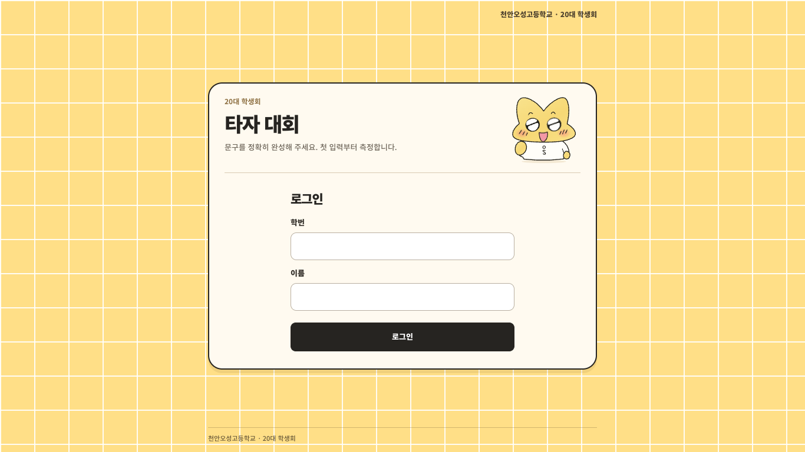
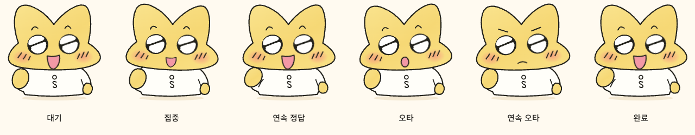
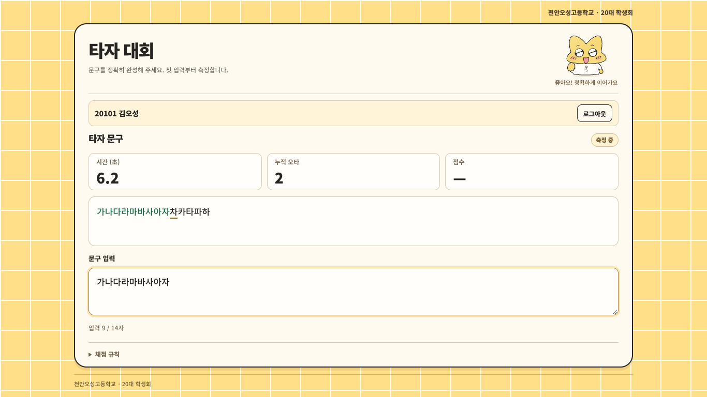
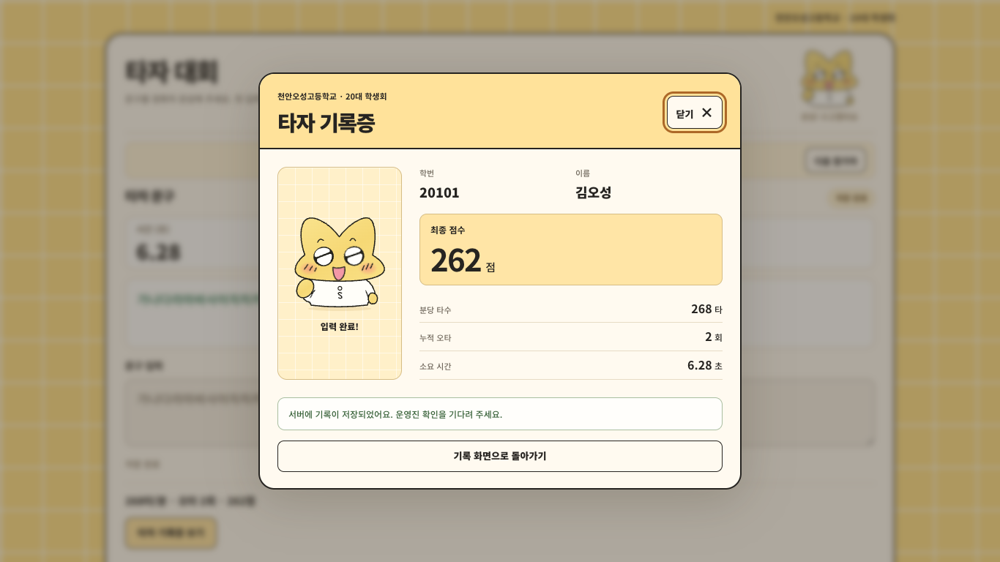

# 오별이 재작화와 로그인 배치 수정

2026-11-16 후속 요청을 반영했다. 브랜치는 `design/obyeol-retro-grid`다.

## 변경

- 첫 번째 첨부 사진을 기준으로 SVG를 다시 그렸다. 깊게 파인 별 얼굴, 기울어진 큰 검정 눈과 둥근 흰 부분, 넓은 웃는 입, 노란 손과 짧고 넓은 흰 상체 비율을 반영했다.
- 머리·몸통·손·눈·입의 그룹과 입력 반응을 유지했다. 새 그림에 맞춰 기준 좌표와 가로세로 비율을 조정했다.
- 정적 `assets/obyeol.svg`와 동적 `typing/obyeol.js`에 같은 그림을 적용했다. 랜딩·글쓰기·공개 글 이미지의 크기 속성도 새 비율에 맞췄다.
- 로그인 외곽 카드를 1080px에서 660px로, 입력 폼을 440px에서 380px로 줄였다. 학번·이름·로그인 버튼의 세로 배치를 유지하고 화면 중앙에 배치했다. 상단 학교 표기와 하단 선도 카드 너비에 맞췄다.
- 로그인 후에는 진행 화면에 필요한 넓은 카드로 전환한다. 오별이 이름표와 행사 목록 버튼은 제거된 상태를 유지한다.

## 데스크톱 검증

이번 후속 작업에서는 사용자의 요청에 따라 모바일 테스트를 실행하지 않았다.

| 화면 | 외곽 카드 | 세로 중심 오차 | 입력칸 너비 | 결과 |
| --- | --- | --- | --- | --- |
| 1366×768 | 660px, 위 140px~아래 628px | 1px 미만 | 380px | 세로 배치, 가로 넘침 없음 |
| 1710×1060 | 660px, 위 281px~아래 783px | 약 2px | 380px | 세로 배치, 가로 넘침 없음 |

Chrome에서 실제 앱·입력 엔진·채점·IndexedDB를 사용하고 Firebase 제출 경계만 모의 응답으로 대체하여 대기→집중→오타→연속 오타→정확한 입력 복귀→연속 정답→완료를 확인했다. 새 입 모양의 전환, 기록증의 새 오별이, 저장 성공 표시, Escape 후 포커스 복귀를 확인했다. 누적 오타 2회일 때 기존 점수에서 6점이 감점되는 것도 확인했다.

모의 응답 없는 실제 Firebase 문구 조회와 입력 준비 상태도 확인했다. 실제 서버 기록은 생성하지 않았다. `typing/app.js`, 엔진·채점·저장·기록증·로그인 JS, Firebase·관리자 파일은 이번 수정에서 변경하지 않았다. SVG XML 파싱, JS 구문 검사, Git 공백 검사를 통과했다.

## 검수 화면

데스크톱 전용 회귀 검사는 로컬 서버를 실행한 뒤 `node tests/typing-redraw-desktop.cjs`로 재실행할 수 있다. Playwright와 Google Chrome이 필요하며, 캡처는 기본 `/tmp/oshs-v6-redraw`에 저장한다.
