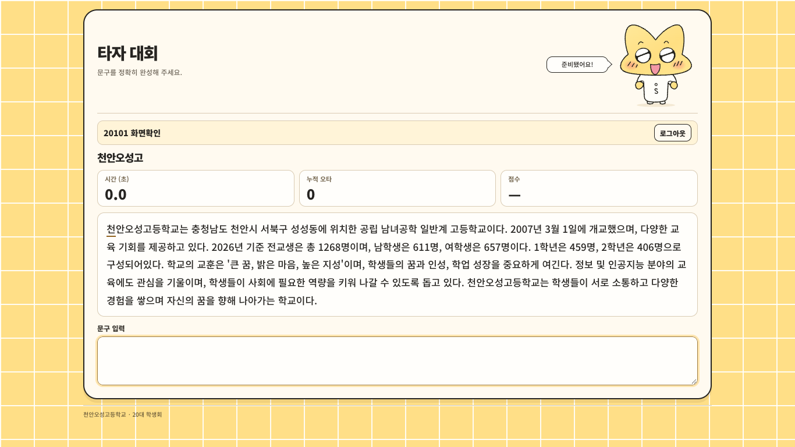
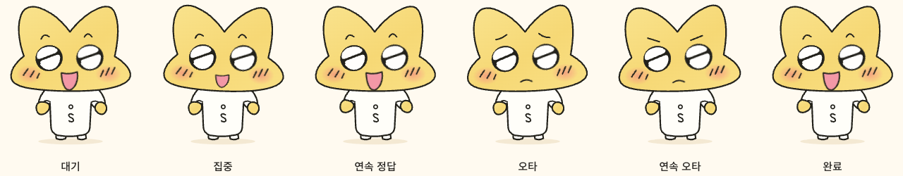
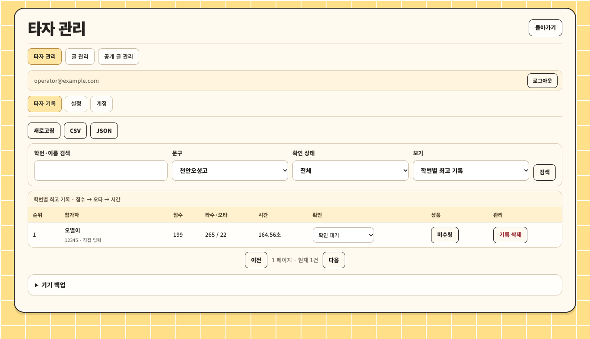

# 타자 화면·관리자 화면·저장 오류 진단

2026-11-16 후속 요청 반영. `design/obyeol-retro-grid`에서 작업했다.

## 실제 저장 거절 원인

사용자의 실제 Chrome 관리자 세션에서 기기 백업을 내보내 보관된 오류를 확인하고, 새 읽기 전용 진단으로 서버의 접수 영수증·공식 참여 키·연결된 결과를 조회했다.

실패한 미전송 기록은 기존 공식 참여 키가 다른 접수 ID를 가리키고 있었으며, 그 키에 연결된 결과 문서는 현재 없었다. 실패한 새 UUID에는 접수 영수증이 없었다. 따라서 새 기록은 중복 참여 제한에 의해 거절되었다. 공개 화면의 다른 참가자 기록과 혼동하여 판단하지 않았다.

기록 삭제만으로 공식 참여 제한을 해제하지 않는 기존 정책은 유지했다. 실제 기록·보관 중인 기록·참여 키를 수정하거나 삭제하거나 재전송하지 않았다. 기록 저장과 관리자 검수에 장애가 있다는 결론으로 일반화하지 않았다.

관리자 **기기 백업 → 저장 실패 원인 확인**은 읽기만 수행한다. 이미 접수된 UUID, 다른 접수에 사용된 참여 키, 삭제된 결과에 남아 있는 참여 키, 문구·점수 불일치, 현재 정보만으로 확정할 수 없는 규칙 거절을 구분한다. 학생에게 비공개 참여 키의 조회 권한을 추가하지 않았다.

학생 화면과 기록증에는 원래 서버 거절 메시지도 표시하여 단순한 저장 실패로만 보이지 않게 했다. 서버 저장 성공 여부, 기기 보관, 파일 백업·재시도 흐름은 유지한다.

## 화면 수정

- 문구 패널의 모든 높이 제한과 내부 스크롤·자동 스크롤을 제거했다. 현재 운영 문구 전체가 읽히며, 훨씬 긴 문구는 페이지 높이가 늘어난다.
- 둥근 측정 상태 칩을 제거하고, 입력 대기·측정 중 배지는 표시하지 않는다. 저장·실패·중단 상태는 필요한 때 일반 텍스트로 표시한다.
- 제목 위·화면 위의 중복 학생회 표기와 “첫 입력부터 측정합니다” 안내를 제거했다. 학교·학생회 표기는 작은 푸터와 필수 기록증 정보에 남긴다.
- 오별이의 넓은 몸통을 이전 느낌의 가벼운 몸과 작은 손·발로 바꿨다. 참고 사진에서 반영한 얼굴·눈은 유지했다.
- 반응 문구는 캐릭터 옆 말풍선으로 표시한다. 한 번의 오타에는 실망한 입·눈썹을, 연속 오타에는 화난 표정을 표시한다.
- 오타 표정은 최소 약 1.4초와 정확한 입력 4회가 충족될 때까지 유지한다. 타이머로 임의의 표정을 만들지 않고 확정된 입력 이벤트에서만 회복 여부를 평가한다. 정확한 입력은 연속 오타 횟수를 즉시 끊으며, 입력 완료는 축하 상태로 전환한다.
- 로그인은 660px 카드와 380px 세로 입력 폼을 유지하고 화면 중앙에 놓았다.
- 관리자 화면에는 불투명한 크림색 작업 영역과 흰색 표·폼을 적용하고 간격을 줄였다. 격자는 화면 바깥 배경에 남긴다.

## 검증 범위

이번 작업에서 모바일 테스트는 실행하지 않았다.

- Chrome 데스크톱 1366×768, 1710×1060에서 로그인 중앙 배치·세로 입력·가로 넘침 없음 확인.
- 실제 Firebase에서 현재 운영 문구를 읽고 입력 준비 상태 확인. 1366×768에서 문구 전체와 입력 영역을 렌더링하여 검수.
- 실제 앱·입력 엔진·채점·IndexedDB를 사용하는 데스크톱 회귀 검사 통과. 제출 경계는 모의 응답으로 대체했다. 대기·집중·실망 유지·연속 오타·정확한 입력 회복·연속 정답·완료·기록증·포커스·오타당 3점 감점을 확인했다.
- 긴 문구의 높이가 내용에 맞춰 늘어나며 마지막 글자까지 패널 안에 놓이는 것 확인. 문구의 내부 세로 스크롤 없음 확인.
- 모의 제출 거절에서 원래 오류 메시지·기기 보관 표시·재시도 포커스 복귀 확인.
- 관리자 화면은 데스크톱 두 크기의 예시 자료로 검수한 뒤 실제 로그인된 Chrome에서도 새 표·폼·진단 결과를 확인했다. 실제 서버 데이터는 변경하지 않았다.
- 진단 함수의 읽기 전용 분류 6개 테스트 통과. 참여 키에 결과가 있는/없는 경우, 순서가 일치하는 접수 해시, 현재 정보로 원인을 확정할 수 없는 경우, 문구 변경, 잘못된 입력을 다룬다.
- JS 구문 검사와 Git 공백 검사 통과. 입력 엔진·채점 함수·Firestore 규칙의 변경 없음.

재실행은 Node.js와 Playwright·Chrome을 준비하고 `node serve.mjs 5176` 실행 후 다음 명령을 사용한다.

```sh
node tests/typing-redraw-desktop.cjs
node tests/typing-diagnostic.mjs
```

`tests/typing-ui.mjs`는 최초 전체 반응형 검사 파일로, 기대값만 현재 동작에 맞췄으며 이번에는 실행하지 않았다.






