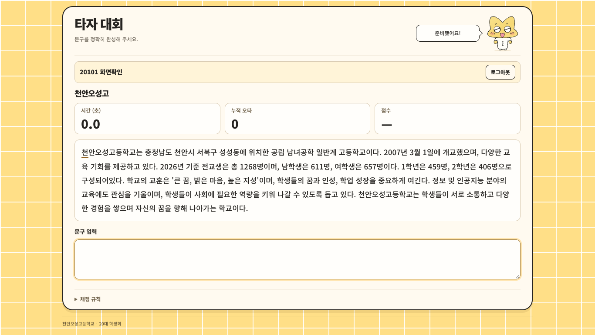
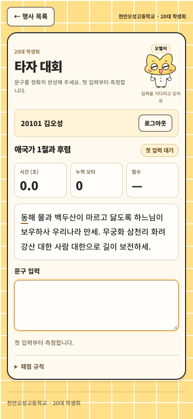
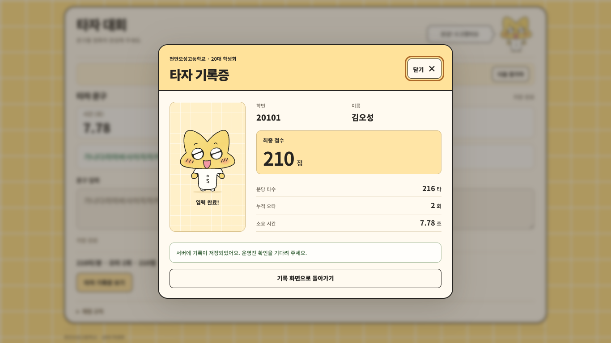
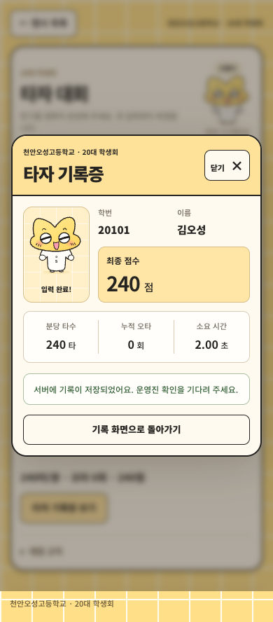

# 타자 대회 V6 구현·검증 기록

최신 수정은 [타자 화면·관리자 화면·저장 오류 진단](usability-fixes.md)을 참고한다.

이전 후속 디자인 수정과 데스크톱 검증은 [오별이 재작화·로그인 배치 수정](reference-redraw.md)에 정리했다. 아래 모바일 검증은 최초 V6 작업 당시의 기록이다.

검수일: 2026-11-16 (한국 시간). 작업 브랜치: `design/obyeol-retro-grid`.

## 화면과 입력 반응

제공된 V5 오버레이와 `assets/obyeol.svg`를 적용했다. 랜딩의 참여 메뉴는 타자 대회와 글쓰기 두 개이며, 기존 공개 글 기능의 주소와 중립적 명칭은 유지했다.

타자 화면은 로그인 전후에 같은 외곽 카드와 정렬을 사용한다. 데스크톱에서는 오별이를 입력 영역 오른쪽에, 모바일에서는 제목 옆에 배치한다. 높이가 낮은 노트북에서는 소개·입력 영역의 간격을 줄인다. 긴 문구는 패널 내부에서만 스크롤하며 현재 입력 위치를 따라간다. 작은 모바일 화면은 세로 스크롤을 허용하고 입력·기록 영역을 우선한다.

오별이는 V5 SVG의 연결된 얼굴·몸 실루엣을 유지한다. 기본 둥실거림과 이벤트 반응을 별도 SVG 그룹에 적용하여 표정 전환 때 기본 움직임이 초기화되지 않는다. 눈 깜빡임, 얼굴 각도, 입, 손, 몸의 탄성을 CSS로 움직인다. 애니메이션용 JS 프레임 루프나 감정 전환 타이머를 추가하지 않았다. `prefers-reduced-motion`에서는 움직임과 전환을 끈다.

표정은 확정된 입력의 이전·이후 엔진 상태로 결정한다. 새 오타가 있으면 놀람→연속 오타 표정이 되고, 정확한 입력을 재개하면 누적 오타와 관계없이 집중 표정으로 복귀한다. 정확한 입력 이벤트가 8회 이어지면 가볍게 뛰고, 완성 시 축하 점프를 한다. 한글 조합 중에는 오타 표정이나 오답색을 적용하지 않고 점선으로 표시한다.

## 기록증과 저장 상태

학생증 형태의 기록증에 학번·이름·점수·분당 타수·누적 오타·소요 시간을 표시한다. 서버 저장 중, 서버 저장 성공, 서버 저장 실패와 기기 보관, 기기 보관도 실패한 경우를 구분한다. 파일 저장 확인 후에도 서버 저장 완료라고 표시하지 않는다.

네이티브 `dialog`와 명시적인 Tab/Shift+Tab 순환, Escape·닫기·배경 클릭, 포커스 복원을 사용한다. 저장 실패 후에는 기존 재시도 버튼으로 돌아간다. 기록증을 닫고 다시 열 수 있고, 다음 참가자로 넘어가면 이전 참가자 정보가 지워진다.

`typing/engine.js`, `typing/scoring.js`, `typing/storage.js`, `login.js`, `db/`, 관리자 JS와 보안 규칙은 수정하지 않았다. 기존 HTML ID와 저장 재시도·파일 백업 이벤트도 유지했다. `typing/app.js`에는 표시·반응·문구 내부 스크롤 연결만 추가했다. 오타당 3점 감점과 재시도 시 동일 기록 ID·데이터 사용을 테스트했다.

## 실제 브라우저 검증

Chrome과 Playwright WebKit에서 아래 시나리오를 실행하고 화면 캡처를 직접 확인했다. WebKit 검사는 실제 iPhone 기기 검사를 의미하지 않는다.

| 항목 | 결과와 검증 범위 |
| --- | --- |
| 로그인 전후 레이아웃 | 1365×900, 1366×768, 1024×768, 768×1024, 390×844, 320×740에서 제목·오별이 표시 및 가로 넘침 없음 |
| 노트북 한 화면 배치 | 기본 문구 및 긴 문구 테스트에서 1366×768 카드 하단이 뷰포트 안에 들어옴 |
| 입력 반응 | 대기→집중→놀람→연속 오타→정확한 입력 복귀→연속 정답→완료 확인 |
| 한글 조합 | compositionstart/beforeinput/input/compositionend를 재현하여 중간 자모 미감점·중립 표시·확정 후 판정 확인 |
| 삭제·선택 수정 | 삭제 추가 감점 없음, 선택 수정 후 표정 복귀, 누적 오타 유지 |
| 글자 표시 | 정답 글자색·오답 글자색/밑줄, 글자 배경 투명 확인 |
| 긴 문구 | 패널 내부 스크롤과 현재 입력 위치 추적 확인 |
| 기록증 | 참가 정보·계산 결과·모바일 배치·저장 중/성공/실패 표시 확인 |
| 접근성 | Tab 순환, Escape, 닫기, 재열기, 실패 시 재시도 버튼 포커스 복귀 확인 |
| 서버 실패 | Firebase 경계만 모의 실패시킴. 실제 storage 모듈과 IndexedDB의 pending 보관 확인 |
| 저장 재시도 | 모의 서버 응답 복구 후 동일 ID·동일 데이터 재제출과 성공 표시 확인 |
| 이중 저장 실패 | 모의 서버 실패와 IndexedDB 비활성화, JSON 다운로드·파일 저장 확인·정확한 상태 문구 확인 |
| 기존 입력 제한 | 붙여넣기 차단, 창 이탈 시 중단·미저장 확인 |
| 모션 감소 | reduced-motion 환경에서 애니메이션 비활성화 확인 |
| 실제 Firebase 조회 | 모의 응답 없이 참가 정보 입력→현재 운영 문구 조회→입력 준비 상태까지 확인. 서버 저장은 수행하지 않음 |
| 코드 보존 | 기존 필수 ID 보존, 보호 대상 파일의 Git diff 없음, JS 구문 검사·git diff --check 통과 |

실제 서버 저장, 중복 참여의 실서버 거부, 관리자 검수·Firebase 보안 규칙의 배포 후 동작, 실기기 소프트 키보드와 OS 한국어 IME는 이번 자동 검증에 포함하지 않았다. 서버 저장 성공·실패는 모의 응답으로 구분하여 시험했다. 운영 데이터는 생성하지 않았다.

## 변경 파일

- `index.html`, `style.css`, `assets/obyeol.svg`: V5 행사 디자인과 두 가지 참여 메뉴.
- `typing/index.html`, `typing/style.css`: 일관된 진행 화면·반응형 배치·기록증.
- `typing/obyeol.js`: V5 원화를 분리한 SVG와 입력 기반 표정 상태.
- `typing/record-card.js`: 기록증 표시·저장 상태·닫기·포커스 관리.
- `typing/app.js`: 기존 입력/저장 상태와 새 표시 모듈 연결.
- `write/index.html`, `welcome/index.html`: 기존 ID와 기능을 유지한 V5 화면 적용.
- `serve.mjs`: 로컬 SVG 응답 MIME 추가.
- `.gitignore`: 제공 SVG·검증 코드·검수 자료 추적 허용.
- `tests/typing-ui.mjs`: 실제 앱과 IndexedDB를 사용하는 브라우저 회귀 테스트. Firebase 경계만 대체한다.
- `docs/v6/`: 검증 기록과 예시 데이터로 촬영한 검수 화면.

## 재실행

Node.js 20 이상, Node에서 불러올 수 있는 Playwright와 설치된 Google Chrome이 필요하다. WebKit 검수에는 Playwright WebKit 브라우저도 필요하다. 이 저장소는 별도 빌드 단계 없이 정적 파일을 제공한다.

```sh
node serve.mjs 5176
```

다른 터미널에서 실행한다.

```sh
node tests/typing-ui.mjs
TEST_BROWSER=webkit V6_ARTIFACT_DIR=/tmp/oshs-v6-webkit node tests/typing-ui.mjs
```

기본 캡처와 결과 JSON은 `/tmp/oshs-v6-review`에 생성된다. `TEST_BASE_URL`과 `V6_ARTIFACT_DIR`로 주소·출력 위치를 변경할 수 있다. 테스트는 Firebase 모듈 경계를 교체하므로 운영 서버에 제출하지 않는다.

## 검수 화면

아래 기록증의 참가 정보와 기록은 테스트용 예시 데이터다.








